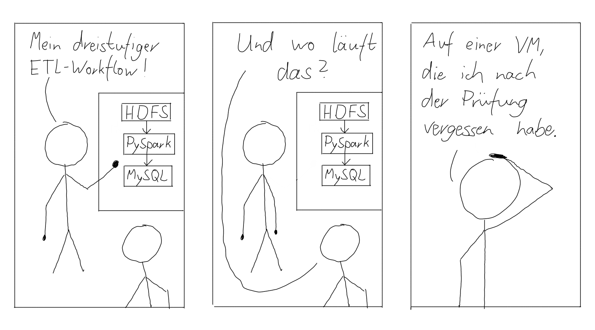
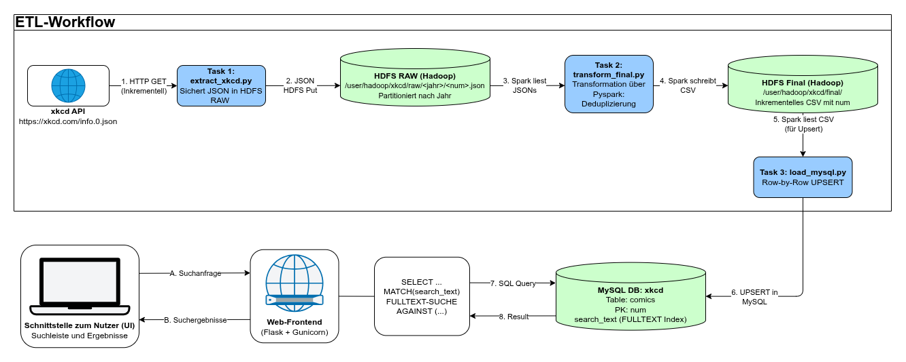

# XKCD Searchable Database

Prüfungsleistung im fünften Semester an der DHBW Stuttgart im Studiengang Informatik im Wahlfach Big Data (https://github.com/marcelmittelstaedt/BigData).
Aufgabenstellung: [Use XKCD API To Build A Searchable Database](https://github.com/marcelmittelstaedt/BigData/blob/master/slides/winter_semester_2026-2027/5_Practical%20Exam.pdf)

*Comic: eigene Zeichnung, angelehnt an [xkcd](https://xkcd.com) von Randall Munroe ([CC BY-NC 2.5](https://creativecommons.org/licenses/by-nc/2.5/))*

Von den XKCD Comics (https://xkcd.com) über die JSON API: https://xkcd.com/info.0.json den aktuellsten Comic abrufen und von dessen Nummer die vorherigen Nummern automatisch durchlaufen und die JSON-Dateien in HDFS über deren jeweilige Jahreszahl ablegen. Im nächsten ETL werden die JSON-Dateien ausgelesen, transformiert und in CSV-Dateien abgelegt. Im Anschluss werden diese CSV-Dateien über einen weiteren ETL in MySQL in dem table: comics; eingefügt.

## Architektur

*Vereinfachte Darstellung der Architektur*

Der komplette Workflow ist als Airflow-DAG `xkcd_etl` (dags/xkcd_etl.py) implementiert und läuft automatisch täglich (`@daily`).
Task-Kette: `extract_xkcd >> transform_final >> load_mysql`.

## Voraussetzungen

- **Betriebssystem:** Linux (getestet auf Ubuntu 20.04 / GCP-VM)
- **Hardware:** mind. 4 GB RAM frei für die Container (empfohlen 6 GB; der Stack betreibt Hadoop/Spark, Airflow, MySQL und Web parallel)
- **Docker inkl. Compose-Plugin:**
    `curl -fsSL https://get.docker.com | sudo sh`
- **git**
- **Freie Ports** auf dem Host: `80` (Web), `8080` (Airflow UI), `9870`/`8088` (HDFS/YARN UI)
- **Internetzugriff** (xkcd-API, Docker Hub) 

## Setup & Start

    git clone https://github.com/inf24234/xkcd-search-database.git
    cd xkcd-search-database

docker compose up -d --build

Beim allerersten Start initialisieren alle Dienste, Status prüfen:

    docker compose ps
    docker compose logs -f airflow # bis der Webserver läuft

**Bediengung:**

- Airflow UI: `http://<host>:8080`
- Web-Frontend: `http://<host>`

## ETL-Workflow im Detail

### 1. extract_xkcd (etl/extract_xkcd.py)
Zweck: Lädt nur die fehlende Comics die noch nicht im HDFS /user/hadoop/xkcd/raw/<jahr>/ als JSON abgelegt sind. Das neuste Comic wird über die Nummer via info.0.json (unter: https://xkcd.com/info.0.json findet sich das neuste Comic). Dabei werden Retry mit exponentiellen Backoff, HTTP Errorcodes 404 werden übersprungen und über eine Pause pro Request (Standard 0,5 s) die API abgerufen. Die JSONs über die API werden in HDFS nach deren Erscheinungsjahr partitioniert.

### 2. transform_final (etl/transform_final.py)
Zweck: PySpark auf dem Hadoop-Cluster. Publikatiomsdatum wird aus year/month/day zusammengestellt, title als Fallback bei safe_title, Deduplizierung über num, search_text aus title + alt zusammengestellt.

### 3. load_mysql (etl/load_mysql.py)
Zweck: Spark liest CSV partitioniert, foreachParition schreibt per pymysql, UPSERT via ON DUPLICATE KEY UPDATE.

### 4. Web-Frontend (web/)
Zweck: Flask mit FULLTEXT-Suche, Treffer nach num absteigend, Limit 100

## Datenmodell

- Raw-Layer: HDFS, partitioniert nach Jahr, Original-JSON der API
- Final-Layer: HDFS, CSV mit num, pub_date, title, link, img, alt, search_text
- End-User-DB: MySQL Tabelle comics (sql/comics.sql) mit FULLTEXT-Index auf search_text