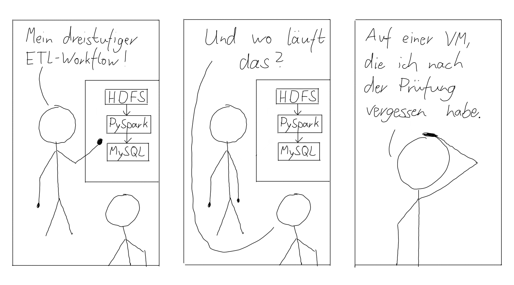
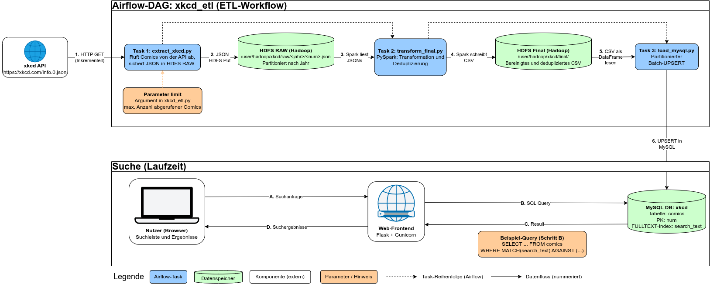
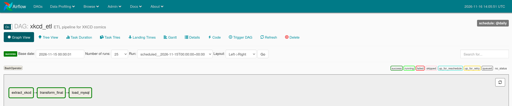
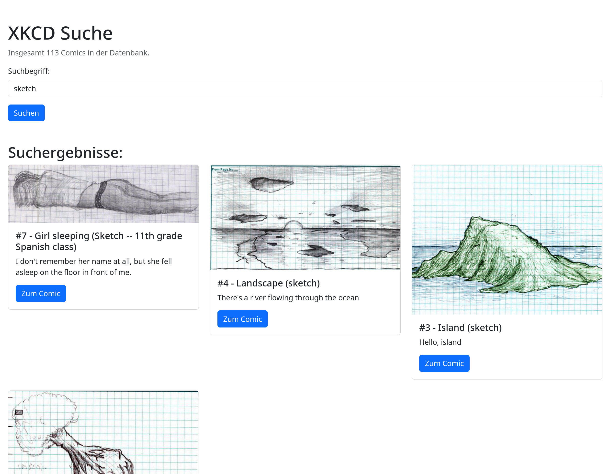

# XKCD Searchable Database

Prüfungsleistung im fünften Semester an der DHBW Stuttgart im Studiengang Informatik im Wahlfach Big Data ([Kursrepo](https://github.com/marcelmittelstaedt/BigData)).
Aufgabenstellung: [Use XKCD API To Build A Searchable Database](https://github.com/marcelmittelstaedt/BigData/blob/master/slides/winter_semester_2026-2027/5_Practical%20Exam.pdf)


*Comic: eigene Zeichnung, angelehnt an [xkcd](https://xkcd.com) von Randall Munroe ([CC BY-NC 2.5](https://creativecommons.org/licenses/by-nc/2.5/))*

## Überblick

Das Projekt baut eine durchsuchbare Datenbank der xkcd-Comics auf:
1. Über die JSON-API (<https://xkcd.com/info.0.json>) wird der aktuellste Comic abgerufen. Ausgehend von dessen Nummer werden die vorherigen Comics automatisch durchlaufen (standardmäßig max. 100 pro DAG-Ausführung, siehe DAG-Parameter `limit`), und die JSON-Dateien werden in HDFS nach Erscheinungsjahr abgelegt.
2. Ein zweiter ETL-Schritt liest die JSON-Dateien aus, transformiert sie und legt das Ergebnis als CSV in HDFS ab.
3. Ein dritter ETL-Schritt lädt die CSV-Dateien in die MySQL-Tabelle `comics`.
4. Ein Flask-Frontend ermöglicht die Volltextsuche über diese Tabelle.

## Architektur


*Vereinfachte Darstellung der Architektur: oben der ETL-Workflow (Schritt 1 bis 6), unten der Suchablauf (Schritt A bis D)*

Der komplette Workflow ist als Airflow-DAG `xkcd_etl` (dags/xkcd_etl.py) implementiert und läuft automatisch täglich (`@daily`).
Task-Kette: `extract_xkcd >> transform_final >> load_mysql`.

| Schritt | Beschreibung |
|---|---|
| 1 | `extract_xkcd` ruft die API per HTTP GET ab (nur fehlende Comics) |
| 2 | Die JSON-Dateien werden per HDFS Put in `/user/hadoop/xkcd/raw/<jahr>/` gespeichert |
| 3 | `transform_final` liest die JSON-Dateien mit Spark |
| 4 | Spark schreibt das bereinigte CSV nach `/user/hadoop/xkcd/final/` |
| 5 | `load_mysql` liest das CSV mit Spark |
| 6 | UPSERT der Daten in die MySQL-Tabelle `comics` |
| A-D | Suchanfrage des Nutzers → SQL-Query des Frontends → Ergebnis von MySQL → Anzeige der Treffer |

## Datenquelle: xkcd-API

Die [JSON-API von xkcd](https://xkcd.com/json.html) liefert zu jedem Comic Metadaten.
Der aktuellste Comic ist über <https://xkcd.com/info.0.json> erreichbar, ein konkreter Comic über `https://xkcd.com/<nummer>/info.0.json`.

Beispielantwort (Text bei `"alt":` gekürzt):

```json
{
    "month": "10",
    "num": 2054,
    "link": "",
    "year": "2018",
    "news": "",
    "safe_title": "Data Pipeline",
    "transcript": "",
    "alt": "\"Is the pipeline literally running from your laptop?\" ...",
    "img": "https://imgs.xkcd.com/comics/data_pipeline.png",
    "title": "Data Pipeline",
    "day": "3"
}
```

## Voraussetzungen

- **Betriebssystem:** Linux (getestet auf Ubuntu 20.04 / GCP-VM)
- **Hardware:** mind. 4 GB RAM frei für die Container (empfohlen 6 GB; der Stack betreibt Hadoop/Spark, Airflow, MySQL und Web parallel)
- **Docker inkl. Compose-Plugin:**

```bash
curl -fsSL https://get.docker.com | sudo sh
```
    
- **git**
- **Freie Ports** auf dem Host: `80` (Web), `8080` (Airflow UI), `9870`/`8088` (HDFS/YARN UI)
- **Internetzugriff** (xkcd-API, Docker Hub) 

## Setup & Start
```bash
git clone https://github.com/inf24234/xkcd-search-database.git
cd xkcd-search-database
docker compose up -d --build
```
Beim ersten Start werden die Container automatisch erstellt und initialisiert. Der erste Start kann wegen der Hadoop- und Airflow-Initialisierung etwas länger dauern.

Den Status der Container kann man prüfen mit

```bash
docker compose ps
```

Die Airflow-Logs können bei Bedarf verfolgt werden:

```bash
docker compose logs -f airflow
```

Um die Container zu beenden:
```
docker compose down
```
Die persistenten Daten bleiben dabei erhalten.
Um zusätzlich alle angelegten Volumes zu löschen:
```
docker compose down -v
```
Hierbei werden die HDFS-Daten des Hadoop-Volumes (`hadoop_data`) und die MySQL-Datenbank gelöscht.

**Bedienung:**

| Dienst | URL |
|---|---|
| Airflow UI | `http://<host>:8080` |
| Web-Frontend | `http://<host>` |
| HDFS NameNode UI | `http://<host>:9870` |
| YARN UI | `http://<host>:8088` |

Der DAG `xkcd_etl` ist für einen täglichen Lauf (`@daily`) konfiguriert. Damit der Scheduler den DAG ausführt, muss der DAG in der Airflow UI auf **On** gestellt werden. Beim Aktivieren kann Airflow einen fälligen geplanten Lauf anlegen. Ein automatisch geplanter Lauf verwendet die Standardwerte des DAGs:

- `limit = 100`
- `order = desc`

Beim ersten Start kann die Datenbank vollständig befüllt werden, indem der DAG einmalig über die Kommandozeile mit `limit = 0` gestartet wird.

### Initiale Befüllung und manuelle Läufe

Für die erstmalige Befüllung werden alle noch fehlenden Comics geladen

```bash
docker compose exec -u airflow airflow \
  /home/airflow/.local/bin/airflow trigger_dag xkcd_etl \
  -c '{"limit": 0, "order": "asc"}'
```

`limit = 0` bedeutet, dass alle noch fehlenden Comics verarbeitet werden.
Bereits vorhandene Comics werden übersprungen.

Für den regulären Betrieb können einzelne Läufe mit eigenen Parametern gestartet werden:

```bash
docker compose exec -u airflow airflow \
  /home/airflow/.local/bin/airflow trigger_dag xkcd_etl \
  -c '{"limit": 100, "order": "desc"}'
```

Dabei werden bis zu 100 der neusten Comics verarbeitet.

| Parameter | Bedeutung |
|---|---|
| `limit` | Anzahl der Comics. `0` lädt alle noch fehlenden Comics |
| `order` | `asc` verarbeitet die ältesten zuerst, `desc` die neuesten zuerst |

Der DAG muss in der Airflow UI auf **On** stehen, damit der Scheduler ihn ausführt. Eigene Parameter können nur über die Kommandozeile mit `-c` übergeben werden. Ohne `-c` werden die Standardwerte des DAGs verwendet.

## ETL-Workflow im Detail


*Airflow-Graph des DAGs `xkcd_etl` nach erfolgreicher Ausführung*


### 1. extract_xkcd (etl/extract_xkcd.py)
Lädt nur die fehlenden Comics, die noch nicht unter `/user/hadoop/xkcd/raw/<jahr>` als JSON in HDFS liegen. Der neueste Comic und seine Nummer stammen von <https://xkcd.com/info.0.json>; von dort werden die vorherigen Nummern durchlaufen.
- Pro Lauf werden maximal `limit` neue Comics geladen (Standard: 100).
- Der Wert `limit = 0` lädt alle noch fehlenden Comics.
- Mit `order = asc` werden die ältesten fehlenden Comics zuerst verarbeitet.
- Mit `order = desc` werden die neusten fehlenden Comics zuerst verarbeitet.
- Der DAG überspringt Comics, die bereits in HDFS vorhanden sind.
- Fehlgeschlagene Requests werden mit exponentiellem Backoff wiederholt.
- HTTP-Statuscode `404` wird übersprungen.
- Zwischen zwei Requests liegt eine Pause (Standard 0,5s), um die API zu schonen.
- Die JSON-Dateien werden nach ihrem Erscheinungsjahr partitioniert abgelegt.

### 2. transform_final (etl/transform_final.py)
PySpark auf dem Hadoop-Cluster:
- Das Publikationsdatum (`pub_date`) wird aus `year`, `month` und `day` zusammengesetzt.
- `title` dient als Fallback, falls `safe_title` fehlt.
- Deduplizierung über `num`.
- `search_text` wird aus `title` und `alt` zusammengesetzt.

### 3. load_mysql (etl/load_mysql.py)
Spark liest das CSV als DataFrame und verarbeitet die Daten partitioniert mit `foreachPartition` und schreibt die Daten mit `pymysql` in MySQL, als UPSERT über `ON DUPLICATE KEY UPDATE`. Dadurch kann der DAG beliebig oft laufen, ohne dass Comics doppelt in der Datenbank landen.


### 4. Web-Frontend (web/)
Als CSS-Framework wird [Bootstrap 5.3.9](https://getbootstrap.com/) verwendet.

Flask-Anwendung mit FULLTEXT-Suche auf `search_text`. Die Treffer werden nach num absteigend sortiert (neueste zuerst), nicht nach Relevanz. Pro Suche werden maximal 100 Treffer angezeigt.


*Darstellung der Suchergebnisse Web-Frontend anhand des Begriffs "Sketch"*

## Geschäftsregeln (Business Rules)

|  | Business Rule |
|---|---|
| BR01 | Jeder Comic wird eindeutig über seine Comicnummer (`num`) identifiziert. |
| BR02 | Dubletten werden im Final-Layer entfernt. |
| BR03 | Bereits im HDFS Raw-Layer gespeicherte Comics werden übersprungen. |
| BR04 | Pro Lauf werden standardmäßig max. 100 fehlende Comics geladen |
| BR05 | Nicht existierende Comicnummern (z.B. HTTP-Statuscode `404`) werden übersprungen. Einzelne fehlende Nummern dürfen nicht zum Abbruch der Pipeline führen. |
| BR06 | Der Abruf der Comics kann chronologisch auf- oder absteigend (`order`) gesteuert werden. Die Ablage im Raw-Layer erfolgt partitioniert nach Erscheinungsjahr (`year`). |
| BR07 | Datensätze ohne gültige Nummer (num IS NULL) werden verworfen. |
| BR08 | Als Titel wird primär `safe_title` verwendet, mit `title` als Fallback. |
| BR09 | Die direkte Web-URL <https://xkcd.com/2054/> wird generiert, und die Einzelfelder `year`, `month` und `day` werden zu einem SQL-Datum (`pub_date`) zusammengeführt. |
| BR10 | Für die Volltextsuche werden `title` und `alt` zu search_text kombiniert. Nicht benötige API-Felder (`news`, `link`, `transcript`) werden verworfen |
| BR11 | Suchanfragen im Web-Frontend nutzen den MySQL FULLTEXT-Index auf `search_text`. Ergebnisse werden absteigend nach `num` sortiert und auf max. 100 Treffer begrenzt. |

## Datenmodell

| Layer | Speicherort | Inhalt |
|---|---|---|
| Raw | HDFS, partitioniert nach Jahr | Original-JSON der API |
| Final | HDFS | CSV mit `num`, `pub_date`, `title`, `link`, `img`, `alt`, `search_text` |
| End-User-DB | MySQL-Tabelle `comics` (sql/comics.sql) | Daten des Final-Layers, FULLTEXT-Index auf search_text

Der Raw-Layer wird inkrementell erweitert durch `extract_xkcd.py`. Der Final-Layer wird durch `transform_final.py` bei jedem Lauf vollständig aus allen Raw-JSON-Dateien neu erzeugt. Anschließend liest `load_mysql.py` das vollständige CSV mit Spark als DataFrame und schreibt die Daten partitioniert per `foreachPartition` und `executemany` per UPSERT nach MySQL.

## Projektstruktur
```text
.
├── airflow-image
│   ├── Dockerfile
│   └── startup.sh
├── dags
│   └── xkcd_etl.py
├── docker-compose.yml
├── docs
│   ├── comic.png
│   ├── fig_airflow.png
│   ├── fig_architektur.drawio
│   ├── fig_architektur.png
│   └── fig_web.png
├── etl
│   ├── extract_xkcd.py
│   ├── load_mysql.py
│   └── transform_final.py
├── hadoop-image
│   ├── Dockerfile
│   └── startup.sh
├── README.md
├── sql
│   └── comics.sql
└── web
    ├── app.py
    ├── Dockerfile
    └── templates
        └── index.html
```

## Lizenz und Quellen
- Die Comics und Metadaten stammen von [xkcd.com](https://xkcd.com) (Randall Munroe) und stehen unter [CC BY-NC 2.5](https://creativecommons.org/licenses/by-nc/2.5/).
- Die Nutzung der API folgt der [xkcd-Dokumentation](https://xkcd.com/json.html).